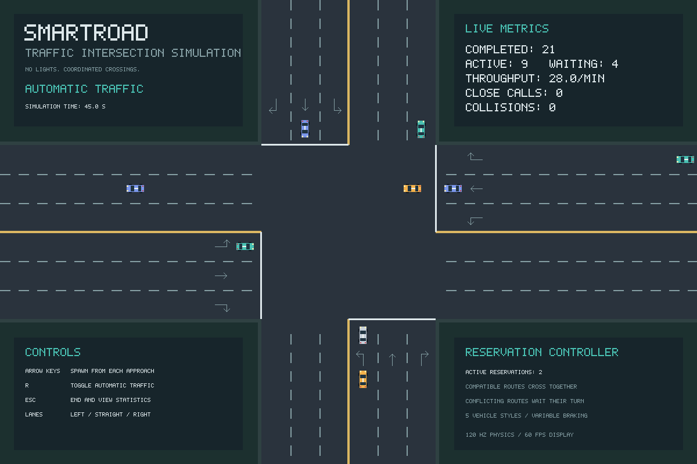

# SmartRoad: Traffic Intersection Simulation

A 2D traffic simulation game I built with **Rust and SDL2**. Send cars into a busy four-way intersection, watch them queue and turn, and see how the traffic flows without traffic lights.



## Play with the traffic

Use the arrow keys to add cars from each direction, or press **R** to let traffic arrive automatically. Cars choose a lane and handle the crossing themselves. Watch queues build, vehicles slow down for turns, and the dashboard update as cars reach the other side.

Press **Esc** when you are finished to see the final statistics.

## What I built

- **Interactive controls:** add traffic manually or switch to automatic mode.
- **Custom graphics:** five vehicle colour styles, road markings and an on-screen dashboard, drawn in code.
- **Vehicle movement:** smooth turns, acceleration and braking across twelve lane routes.
- **Traffic coordination:** cars wait for conflicting traffic to clear before crossing.
- **Live statistics:** completed crossings, speed, waiting time, queues and close calls, with a final report when you exit.

The project brings together game graphics, keyboard input, vehicle movement and traffic logic in a native desktop application.

## Run the game

Install [Rust and Cargo](https://rustup.rs/) and SDL2, then run:

```bash
git clone https://github.com/ihamzaihsan/smart-road.git
cd smart-road
cargo run --bin visual_sim
```

To start with automatic traffic:

```bash
cargo run --bin visual_sim -- --demo
```

<details>
<summary>SDL2 installation and checks — Windows, Linux and macOS</summary>

**Windows**

1. Download the SDL2 development libraries from [libsdl.org](https://www.libsdl.org/download-2.0.php). For the usual x64 MSVC Rust toolchain, choose the `SDL2-devel-…-VC.zip` package; [SDL2 2.28.5](https://github.com/libsdl-org/SDL/releases/tag/release-2.28.5) was verified locally.
2. Extract it to a folder such as `C:\SDL2`, with `lib\x64` directly inside that folder.
3. Set `SDL2_LIB_DIR` to `C:\SDL2\lib\x64` and add that directory to `PATH`.

Choose the commands for your terminal. These settings apply to the current session.

**PowerShell**

```powershell
$env:SDL2_LIB_DIR = "C:\SDL2\lib\x64"
$env:PATH = "$env:SDL2_LIB_DIR;" + $env:PATH
```

**Git Bash**

```bash
export SDL2_LIB_DIR="C:/SDL2/lib/x64"
export PATH="/c/SDL2/lib/x64:$PATH"
```

Git Bash uses `/c/SDL2` for `C:\SDL2` in `PATH`; `SDL2_LIB_DIR` uses a Windows-compatible path for Cargo.

Use your actual installation path. `SDL2_LIB_DIR` must contain `SDL2.lib`; `PATH` must include the matching `SDL2.dll`. You can also save these settings in Windows Environment Variables and open a new terminal. For a copied desktop executable, place the DLL beside it. The project uses the precompiled SDL2 library with your existing Rust toolchain.

Verify the installation in the same terminal before running the app:

**PowerShell**

```powershell
if (Test-Path -LiteralPath "$env:SDL2_LIB_DIR\SDL2.lib" -PathType Leaf) {
    Write-Output "SDL2.lib found"
} else {
    Write-Error "SDL2.lib missing: check SDL2_LIB_DIR"
}
where.exe SDL2.dll
```

**Git Bash**

```bash
test -f "$SDL2_LIB_DIR/SDL2.lib" && echo "SDL2.lib found"
which SDL2.dll
```

The first check should print `SDL2.lib found`; the second should show the DLL's location. If either check fails, confirm the extraction folder and update `SDL2_LIB_DIR` or `PATH`. The DLL should come from the same x64 SDL2 package as the library. These checks confirm file availability; `cargo run --bin visual_sim` verifies that the app builds and launches.

**Linux (Ubuntu / Debian)**

```bash
sudo apt-get install libsdl2-dev
```

**macOS**

```bash
brew install sdl2
export LIBRARY_PATH="$(brew --prefix)/lib:${LIBRARY_PATH:-}"
```

The older setup's full SDL package commands also work:

```bash
# Ubuntu / Debian
sudo apt-get install libsdl2-dev libsdl2-image-dev libsdl2-ttf-dev

# macOS
brew install sdl2 sdl2_image sdl2_ttf
```

Only SDL2 is used by this project: vehicle artwork and bitmap text are generated in Rust, so SDL2_image and SDL2_ttf are optional.

</details>

## Controls

| Key | Action |
| --- | --- |
| Up | Add a car travelling north from the bottom |
| Down | Add a car travelling south from the top |
| Right | Add a car travelling east from the left |
| Left | Add a car travelling west from the right |
| R | Turn automatic traffic on or off |
| Esc / close window | Exit and show final statistics |

Built with Rust and SDL2. For the implementation, additional run options and recorded checks, see the [technical notes](docs/technical-notes.md).
