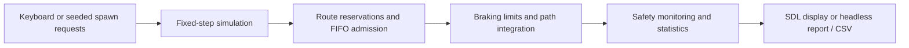

# Technical notes

Implementation details and additional run options for [SmartRoad: Traffic Intersection Simulation](../README.md). For installation and gameplay, start with the README.

## Run without SDL

With Rust and Cargo installed, the same simulation can run without graphics:

```bash
cargo run --locked --release --no-default-features -- --headless --duration 120 --seed 42 --drain
```

This runs automatic traffic as fast as the CPU allows. It simulates 120 seconds of spawn requests, then finishes all accepted vehicles. A seeded run with the same locked dependencies and build is reproducible.

## Scenarios and export

```bash
# Default automatic load: one request every 1.5 simulated seconds
cargo run --locked --release --no-default-features -- --headless --duration 120 --seed 42 --drain

# Saturation scenario: most requests will be rejected safely
cargo run --locked --release --no-default-features -- --headless --duration 120 --seed 7 --spawn-interval 0.05 --drain

# Spreadsheet-friendly final metrics
cargo run --locked --release --no-default-features -- --headless --duration 60 --seed 42 --csv results.csv

# All command-line options
cargo run --locked --no-default-features -- --help
```

Duration accepts 0.1–86,400 seconds; spawn interval accepts 0.05–60 seconds; seeds are unsigned 64-bit integers. Invalid arguments and failed file writes return an error. CSV export overwrites the specified file.

Without `--drain`, statistics include vehicles still on screen as active. With `--drain`, automatic spawning stops at the requested duration and traffic continues until every accepted vehicle exits; draining has a 600-second simulation limit. Safety violations or failure to drain return a nonzero exit status. Desktop `--duration` ends the run and opens the statistics dialog; `--drain` is headless-only. Add `--no-dialog` to print desktop statistics without a modal window, useful for unattended runs.

## Controller and physics

Each approach uses right-hand traffic. Lanes are numbered from the median outwards: left, straight, right. Turning routes use sampled quarter-circle arcs; a vehicle's position and heading come from its distance along an immutable route.

The controller precomputes a 12 × 12 conflict matrix from the minimum distance between route segments. Two reserved paths conflict when their circular vehicle envelopes plus a **10-pixel safety gap** would overlap. The scheduler considers vehicles within 60 pixels of their stop position. Older candidates go first, and a blocked older candidate prevents conflicting newcomers from continually bypassing it. Reservations remain occupied until the full vehicle has cleared the intersection; there is no time-based release.

Vehicle control decisions use the same position/speed snapshot each tick. Cruise, straight-crossing and turn speed targets are 180, 140 and 90 px/s. Acceleration is 100–160 px/s² and braking is 200–280 px/s² depending on vehicle style. Braking limits follow `v² = 2ad`, with an integration margin and leader spacing. Movement integrates average old/new speed over the timestep. A distance cap prevents crossing a stop or leader boundary without resetting velocity.

A separate monitor checks swept relative motion between ticks for every vehicle pair. It counts entries into close-call and collision episodes; violations are recorded without repositioning cars or excluding right turns.



