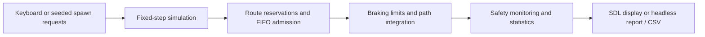

# Technical notes

Implementation details and additional run options for [SmartRoad: Traffic Intersection Simulation](../README.md). For installation and gameplay, start with the README.

## Run without SDL

With Rust and Cargo installed, the same simulation can run without graphics:

```bash
cargo run --locked --release --no-default-features -- --headless --duration 120 --seed 42 --drain
```

This runs automatic traffic as fast as the CPU allows. It simulates 120 seconds of spawn requests, then finishes all accepted vehicles. A seeded run with the same locked dependencies and build is reproducible.

## Scenarios and export

```bash
# Default automatic load: one request every 1.5 simulated seconds
cargo run --locked --release --no-default-features -- --headless --duration 120 --seed 42 --drain

# Saturation scenario: most requests will be rejected safely
cargo run --locked --release --no-default-features -- --headless --duration 120 --seed 7 --spawn-interval 0.05 --drain

# Spreadsheet-friendly final metrics
cargo run --locked --release --no-default-features -- --headless --duration 60 --seed 42 --csv results.csv

# All command-line options
cargo run --locked --no-default-features -- --help
```

Duration accepts 0.1–86,400 seconds; spawn interval accepts 0.05–60 seconds; seeds are unsigned 64-bit integers. Invalid arguments and failed file writes return an error. CSV export overwrites the specified file.

Without `--drain`, statistics include vehicles still on screen as active. With `--drain`, automatic spawning stops at the requested duration and traffic continues until every accepted vehicle exits; draining has a 600-second simulation limit. Safety violations or failure to drain return a nonzero exit status. Desktop `--duration` ends the run and opens the statistics dialog; `--drain` is headless-only. Add `--no-dialog` to print desktop statistics without a modal window, useful for unattended runs.

## Controller and physics

Each approach uses right-hand traffic. Lanes are numbered from the median outwards: left, straight, right. Turning routes use sampled quarter-circle arcs; a vehicle's position and heading come from its distance along an immutable route.

The controller precomputes a 12 × 12 conflict matrix from the minimum distance between route segments. Two reserved paths conflict when their circular vehicle envelopes plus a **10-pixel safety gap** would overlap. The scheduler considers vehicles within 60 pixels of their stop position. Older candidates go first, and a blocked older candidate prevents conflicting newcomers from continually bypassing it. Reservations remain occupied until the full vehicle has cleared the intersection; there is no time-based release.

Vehicle control decisions use the same position/speed snapshot each tick. Cruise, straight-crossing and turn speed targets are 180, 140 and 90 px/s. Acceleration is 100–160 px/s² and braking is 200–280 px/s² depending on vehicle style. Braking limits follow `v² = 2ad`, with an integration margin and leader spacing. Movement integrates average old/new speed over the timestep. A distance cap prevents crossing a stop or leader boundary without resetting velocity.

A separate monitor checks swept relative motion between ticks for every vehicle pair. It counts entries into close-call and collision episodes; violations are recorded without repositioning cars or excluding right turns.



## Statistics

Required metrics cover completed vehicles, maximum/minimum speed, longest/shortest travel time and close calls. Additional metrics include collisions, mean travel time, mean stopped waiting time, throughput, distance travelled by completed vehicles, peak stopped queue, concurrent reservations, rejected requests and active vehicles.

Speed includes startup and stopped samples, so the minimum is normally zero. Travel time begins when the controller detects a vehicle at spawning and ends after it fully leaves the canvas. Waiting time counts ticks spent stopped before admission. Means and travel-time extrema use completed vehicles only; empty samples display `N/A`. Throughput is completed vehicles divided by total simulated time, including draining when requested.

## Verified results

Development checkpoint (commit date): **22 March 2026**.

Recorded checks used Windows x64, Rust 1.88.0 and native SDL2 2.28.5:

| Scenario | Completed / accepted | Close calls | Collisions | Peak stopped queue |
| --- | ---: | ---: | ---: | ---: |
| Seed 42, 120 seconds, 1.5-second interval, drained | 80 / 80 | 0 | 0 | 5 |
| Seed 7, 120 seconds, 0.05-second interval, drained | 223 / 223 | 0 | 0 | 56 |

These are reproducible scenario results, not a proof for every possible workload. Saturation deliberately creates congestion; admission limits reject excess demand rather than claiming unlimited throughput.

Eight temporary verification checks passed, including 100 manual scenarios covering all twelve routes, 40 default/saturated seeded runs, bounded acceleration and braking, deterministic results, configuration validation, reservation retention and encounter counting. The actual Windows desktop loop was also exercised with all four arrows, spam requests, `R`, Escape and empty-window close; both exit paths displayed native statistics dialogs. The screenshot in the README was captured from the real renderer.

Linux x64 was also verified under Ubuntu 26.04.1 / WSL2 with Rust 1.88.0 and system SDL2 2.32.10. Both headless scenarios above matched the Windows results. Native SDL rendered successfully with dummy and X11 video drivers; X11 used a virtual display.

Temporary verification code was removed after use. CI is configured for headless scenarios and native SDL builds/runtime on Windows, Linux and macOS, and passed local `actionlint` validation. Windows uses precompiled SDL2, Linux uses its system package, and macOS uses Homebrew. Remote CI execution and macOS runtime remain pending because the changes are being kept local.

## Code map

| Path | Responsibility |
| --- | --- |
| `src/bin/visual_sim.rs` | CLI validation, headless runner, SDL events and fixed-step desktop loop |
| `src/core/game.rs` | Seeded spawning, simulation orchestration and vehicle lifecycle |
| `src/core/intersection.rs` | Spatial conflict matrix and reservation scheduler |
| `src/core/waypoints.rs` | Immutable lane routes, curves and position/heading lookup |
| `src/core/physics.rs` | Speed targets, braking and path-distance integration |
| `src/core/geometry.rs` | Point/segment and segment/segment geometry |
| `src/components/` | Direction, route, state and vehicle data |
| `src/resources/` | Constants, metrics and original sprite generation |
| `src/rendering/` | SDL roads, cars, controls and live dashboard |
| `build.rs` | Optional `SDL2_LIB_DIR` support for installed SDL2 libraries |
| `.github/workflows/ci.yml` | Build, lint and runtime checks across three operating systems |

The application has three direct dependencies: `rand 0.8`, `nalgebra 0.32`, and optional `sdl2 0.35`. `Cargo.lock` records the resolved versions. The simulation has no rendering dependency when built with `--no-default-features`.
